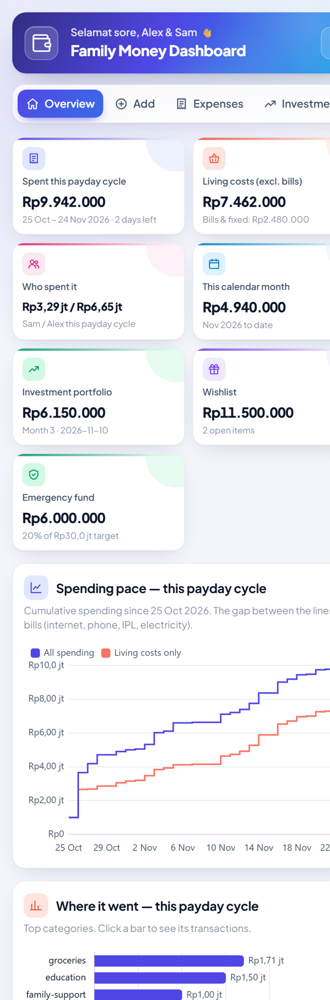
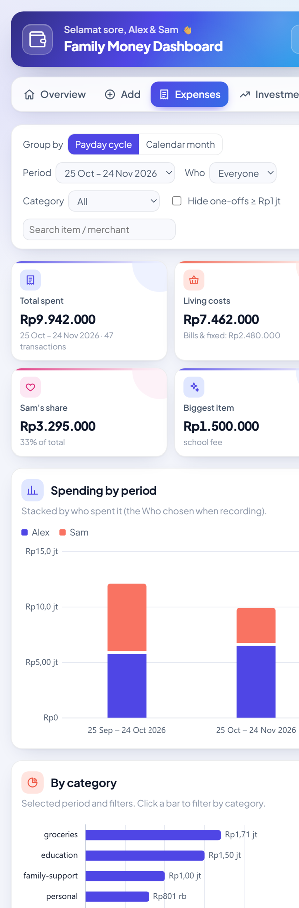
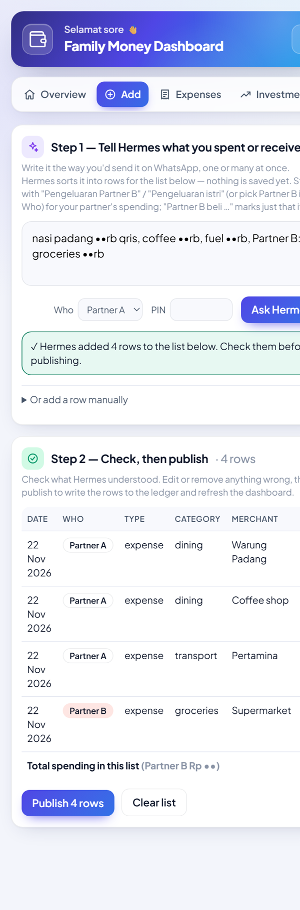
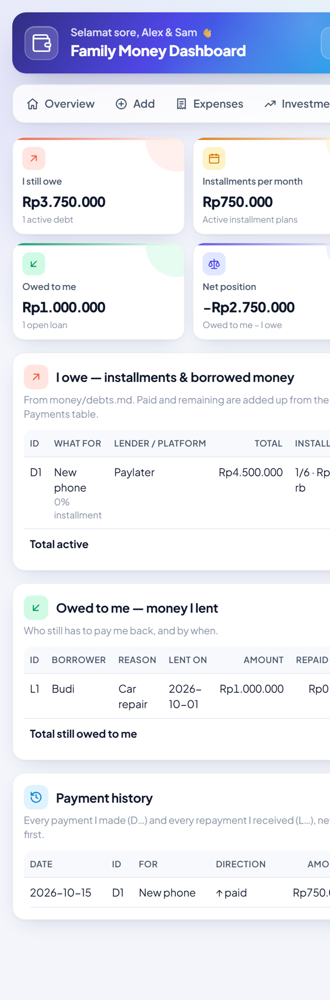
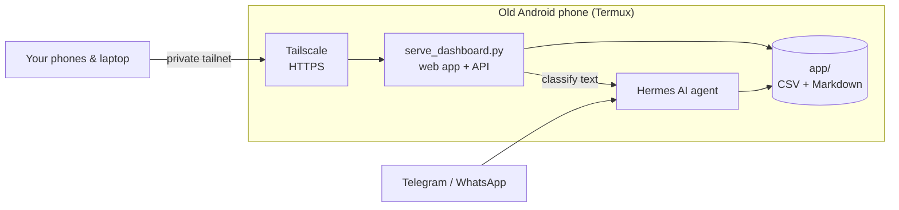

# Money Management Super App

**A personal family money app that runs on an old, unused Android phone, built with AI and open-source tools.**

An old phone was sitting in a drawer. With Claude Code as a pair programmer, it became a small home server for a money app that fits one family's needs: expenses, budget, emergency fund, purchase planning, debts and investments, all in one installable web app that you can open anywhere through a private network.

No cloud server, no subscription, and nobody else's app deciding how you should manage your money.

| Overview | Expenses | Add with AI | Debts & loans |
|---|---|---|---|
|  |  |  |  |

*Screenshots use the fake sample data in this repo.*

## Features

- **One dashboard**: spending this payday cycle, living costs vs bills, who spent what, wishlist and emergency fund progress.
- **Add expenses like a chat**: type "nasi padang 23rb qris, token listrik 500rb". The [Hermes](https://github.com/NousResearch/hermes-agent) AI agent turns it into ledger rows. You check them, then publish with a PIN. You can also add a row by hand.
- **Every expense explained**: by payday cycle or calendar month, by category, by merchant and by person, with search and filters.
- **Emergency fund plan**: target, monthly set-aside and the actual balance vs the plan.
- **Plan before you buy**: a planner that checks a purchase against your real free cash each payday.
- **Debts & loans**: installments you owe and money you lent, with progress, from a simple Markdown table.
- **Investments**: portfolio, allocation limits and an embedded monthly investment report (written by Claude Code, see [`app/CLAUDE.md`](app/CLAUDE.md)).
- **Chat-based recording**: send a receipt or a message to Hermes on Telegram or WhatsApp and it records it. See [`hermes/`](hermes).
- **Installable app (PWA)**: add it to your phone's home screen. It opens like a normal app.
- **Privacy mode**: open the app with `?demo=1` and every amount and name is hidden, for screenshots you want to share.
- **Plain files**: the data is CSV and Markdown in one folder, so you and any AI agent can read and edit it. No database.

## How it works



- `serve_dashboard.py` is a small Python web server (standard library only). It serves the dashboard and has two PIN-protected endpoints: `/api/classify` asks Hermes to turn text into rows, and `/api/publish` appends the rows to the ledger. It only serves the dashboard files: the ledger, notes and settings are never exposed over the network.
- `app/money/build_dashboard.py` reads the CSV and Markdown files and writes one self-contained `index.html` (Chart.js). The server rebuilds it automatically whenever a data file changes, including edits made by Hermes or Claude Code.
- **Tailscale** puts your phone, laptop and the server on a private, encrypted network and gives the app its own HTTPS address. It isn't on the public internet, and only your devices can reach it.
- **Hermes** runs on the same phone for chat-based recording and classification.

## Quick start (any computer, 2 minutes)

You need Python 3.9+. No packages are needed to run the app.

```bash
git clone https://github.com/yuzararyadi/money_management_superapp.git
cd money_management_superapp
MONEY_DASH_CONSOLE=1 python serve_dashboard.py      # Windows PowerShell: $env:MONEY_DASH_CONSOLE=1; python serve_dashboard.py
```

Open http://127.0.0.1:8765. You'll see the sample household "Alex & Sam".

- The PIN for adding data is created on the first start in `~/.money-dashboard/pin.txt`. Change it there if you like.
- "Ask Hermes" needs Hermes installed (see below). Until then, use "Or add a row manually".

### Make it yours

1. Put your names in `app/money/settings.json`.
2. Clear the sample ledger: `python app/money/make_sample_data.py --clear`
3. Edit the Markdown files in `app/money/` (`profile.md`, `budget.md`, `wishlist.md`, `debts.md`) and `app/portfolio.md`. Keep the table headings and columns, because the dashboard reads them.
4. Categories come from the table in `app/money/RECEIPTS.md`. Add or rename them there.
5. Optional: put a photo in `app/money/app-icon-source/` and run `python app/money/make_app_icons.py` (needs Pillow) to use it as the app icon. That folder is git-ignored.

The payday cycle runs from the 25th to the 24th. To change it, edit `cycle_start()` in `build_dashboard.py` and the planner in `dashboard_template.html`.

## Run it on an old Android phone

See **[docs/SETUP-TERMUX.md](docs/SETUP-TERMUX.md)**. It covers:

- Termux
- Hermes inside a Debian proot
- Tailscale HTTPS
- auto-start on boot with Termux:Boot
- optional Syncthing two-way sync with a PC

Ready-made scripts are in [`termux/`](termux).

## Use it with AI agents

The folder is designed so AI agents can work in it safely:

- [`app/CLAUDE.md`](app/CLAUDE.md) and [`app/AGENTS.md`](app/AGENTS.md): rules and the monthly payday and investment workflows for Claude Code or other agents.
- [`app/money/RECEIPTS.md`](app/money/RECEIPTS.md): exactly how to record a receipt or payment.
- [`hermes/skills/.../SKILL.md`](hermes/skills/personal-finance/expense-recording/SKILL.md): a Hermes skill for recording expenses from chat.

## Project structure

```
serve_dashboard.py          web server + PIN-protected API (Python stdlib)
app/
  index.html                generated dashboard (git-ignored)
  manifest.json, sw.js      installable app (PWA)
  icons/                    app icons
  CLAUDE.md, AGENTS.md      instructions for AI agents
  portfolio.md, log.csv, reports/, dashboard.html   investment records (sample)
  money/
    build_dashboard.py      data → index.html
    dashboard_template.html the whole UI (HTML/CSS/JS, Chart.js)
    settings.json           your names
    RECEIPTS.md             recording rules + categories
    profile.md, budget.md, wishlist.md, debts.md   your plan (sample)
    ledger/YYYY-MM.csv      transactions (sample)
    make_sample_data.py     fake data generator
    make_app_icons.py       app icons
termux/                     Android start-up scripts
hermes/                     Hermes skill
docs/                       setup guide, screenshots
```

## Security notes

- Never port-forward the app to the internet. Reach it through Tailscale (or your home Wi-Fi only).
- Adding data needs the PIN. Five wrong PINs lock it for 5 minutes.
- The server only serves the dashboard, the app files, icons and reports. Ledger CSVs, Markdown notes and `settings.json` return 404.
- Keep your own data out of public repositories. If you fork this repo, put your real `app/` data in a private repo, or add `app/money/ledger/` and the Markdown files to `.gitignore`.

## Built with

[Claude Code](https://claude.com/claude-code) · [Hermes Agent](https://github.com/NousResearch/hermes-agent) · [Termux](https://termux.dev) · [Tailscale](https://tailscale.com) · [Syncthing](https://syncthing.net) (optional) · Python · [Chart.js](https://www.chartjs.org)

## License

MIT. See [LICENSE](LICENSE). This is a personal project, not financial advice.
